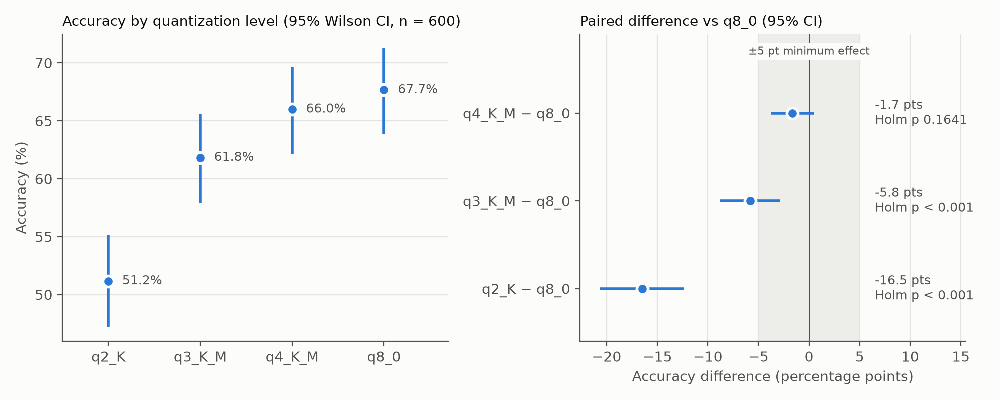

# Does Quantization Degrade LLM Accuracy?

A paired experiment testing whether quantizing **Llama 3.1 8B Instruct** to lower bit-widths reduces its accuracy on **MMLU** multiple-choice questions. Four GGUF quantization levels (Q2_K, Q3_K_M, Q4_K_M, and Q8_0 as the reference) each answered the same 600 questions, run locally through Ollama on an Apple M1 Pro (32 GB).

## Key results

| Level | Accuracy | Difference vs Q8_0 (95% CI) | Holm p |
|---|---|---|---|
| Q8_0 (reference) | 67.7% | | |
| Q4_K_M | 66.0% | −1.7 pts [−3.8, +0.4] | 0.164 |
| Q3_K_M | 61.8% | −5.8 pts [−8.8, −2.9] | < 0.001 |
| Q2_K | 51.2% | −16.5 pts [−20.6, −12.4] | < 0.001 |

- Accuracy differs across levels: Cochran's Q(3) = 98.49, p < 0.001, η²_Q = 0.055.
- **Q4_K_M:** no detectable loss, and the confidence interval rules out a drop of 5 points or more, the minimum effect of interest set before the experiment.
- **Q3_K_M and Q2_K:** significantly less accurate than Q8_0.



## Repository structure

```
.
├── run_experiment.py        # data collection: queries each quantized model on the sampled MMLU items, logs every answer
├── analyze.py               # statistical analysis: tests, effect sizes, power analysis, worked calculations, figure, report
├── requirements.txt
├── data/
│   ├── raw/
│   │   ├── pilot_results.jsonl   # pilot: 50 items x Q4_K_M, Q8_0 (used only for the power analysis)
│   │   ├── pilot_items.json      # item IDs, subjects and answer keys for the pilot sample
│   │   ├── main_results.jsonl    # main run: 600 items x 4 levels, one row per answer
│   │   └── main_items.json       # item IDs, subjects and answer keys for the main sample
│   └── processed/
│       ├── pilot_accuracy.csv
│       ├── pilot_report.md       # power analysis: discordance estimate and sample-size calculation
│       ├── main_accuracy.csv     # accuracy per level with Wilson 95% CIs
│       ├── main_pairwise.csv     # McNemar tests and effect sizes vs Q8_0
│       ├── main_figure.png
│       └── main_report.md        # full analysis output, including worked calculations
└── README.md
```

## Why there is no preprocessing script

Most data projects need a script that turns downloaded raw files into a clean analysis dataset. This one doesn't, by design:

1. **There is no downloaded dataset to clean.** The MMLU questions are not stored in this repository or downloaded by hand. `run_experiment.py` loads the MMLU test split directly from Hugging Face (`cais/mmlu`, configuration `all`) and draws a seeded random sample, so the sample is fully reproducible from the code.
2. **The raw data is created by the experiment itself, already in analysis-ready form.** Each row of `data/raw/*_results.jsonl` is one model's answer to one question at one quantization level, and it already records the answer key, the predicted letter, whether it was correct, and whether the output was valid. Scoring happens at the moment each answer is collected.
3. **Cleaning was designed out at collection time.** Model output is constrained by a JSON schema that only allows the letters A–D, and decoding is deterministic (temperature 0, fixed seed). In the main run this produced **0 invalid outputs and 0 missing responses** across all 2,400 answers.
4. **The few remaining data steps are part of the analysis, so they live in `analyze.py`.** Reshaping to one row per item, keeping only items answered at all four levels, and the sensitivity analysis that excludes invalid outputs are all reported in the analysis output. Moving them into a separate script would split one step into two without changing anything.

In short, `data/raw/` holds the experiment's direct output, and `data/processed/` holds everything `analyze.py` computes from it.

## Experimental design

| | |
|---|---|
| **Independent variable** | Quantization level: Q2_K, Q3_K_M, Q4_K_M, Q8_0 |
| **Dependent variable** | Correct or incorrect on each question |
| **Control** | Q8_0 (effectively lossless reference) |
| **Held constant** | Model, prompt, temperature 0, seed, 2,048-token context, one-letter JSON answer |
| **Design** | Paired: every level answers the same items |
| **Sample** | 600 MMLU test items, seeded random sample (seed 510); the 50 pilot items are held out |
| **Primary test** | Exact McNemar, Q4_K_M vs Q8_0 |
| **Omnibus / post hoc** | Cochran's Q across all levels; exact McNemar for Q3_K_M and Q2_K vs Q8_0, Holm-corrected |

**Sample size.** A 50-item pilot (Q4_K_M vs Q8_0) produced 1 discordant pair, ψ̂ = 0.020 (95% Wilson CI [0.004, 0.105]). Planning with the upper bound (ψ = 0.105), α = 0.05/3, power = 0.80, and a 5-point minimum effect, the required sample is n = 437 (Connor, 1987). The main run used n = 600. The full calculation is in `data/processed/pilot_report.md`.

## Reproducing the results

**Requirements:** Python 3.10+ and [Ollama](https://ollama.com) [version x.x].

```bash
pip install -r requirements.txt
ollama serve            # in a separate terminal, or open the Ollama app
```

**1. Pilot** (50 items, Q4_K_M and Q8_0 only):

```bash
python run_experiment.py --stage pilot --levels q4_K_M q8_0
python analyze.py data/raw/pilot_results.jsonl --min-effect 0.05
```

**2. Main run** (600 items, all four levels; the script downloads each model the first time, about 20 GB total):

```bash
python run_experiment.py --stage main --n 600
python analyze.py data/raw/main_results.jsonl --min-effect 0.05 --equivalence-margin 0.05
```

`run_experiment.py` saves each answer as it arrives, so rerunning the same command after an interruption resumes where it stopped. Use `analyze.py --brief` to skip the worked-calculations section.

**Note on the pilot sample:** keep `--pilot-size` at its default of 50. The main sample starts right after the pilot items in the shuffled order, so a larger pilot would overlap the main sample.

## Writeup and presentation

- Writeup: [link]
- Presentation video: [link]

## References

- Cochran, W. G. (1950). The comparison of percentages in matched samples. *Biometrika, 37*(3/4), 256–266.
- Connor, R. J. (1987). Sample size for testing differences in proportions for the paired-sample design. *Biometrics, 43*(1), 207–211.
- Hendrycks, D., et al. (2021). Measuring massive multitask language understanding. *ICLR*.
- Holm, S. (1979). A simple sequentially rejective multiple test procedure. *Scandinavian Journal of Statistics, 6*(2), 65–70.
- McNemar, Q. (1947). Note on the sampling error of the difference between correlated proportions or percentages. *Psychometrika, 12*(2), 153–157.