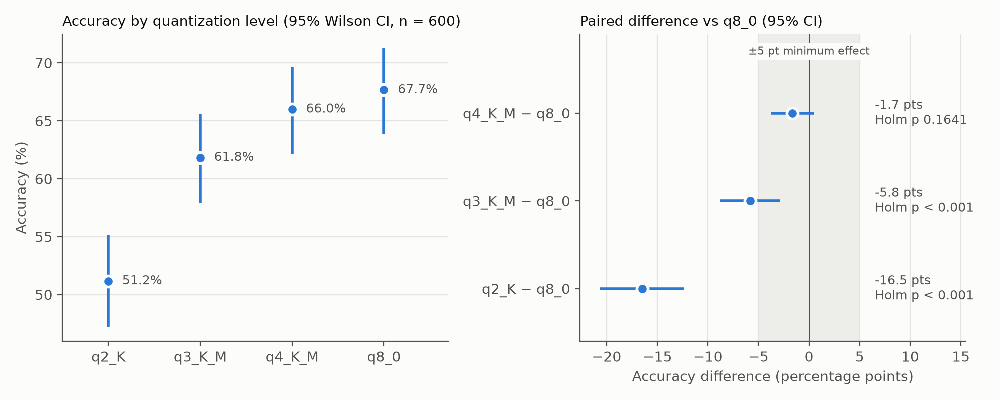

# Quantization experiment: main analysis

- Results file: `data/raw/main_results.jsonl`
- Items analyzed: 600 (complete cases across 4 levels)
- Generated: 2026-11-03 09:27
- Command: `python analyze.py data/raw/main_results.jsonl --min-effect 0.05 --equivalence-margin 0.05`

## 1. Accuracy

| Level | Correct | Accuracy | 95% Wilson CI | Invalid outputs |
|---|---|---|---|---|
| q2_K | 307/600 | 51.2% | [47.2, 55.1] | 0 |
| q3_K_M | 371/600 | 61.8% | [57.9, 65.6] | 0 |
| q4_K_M | 396/600 | 66.0% | [62.1, 69.7] | 0 |
| q8_0 | 406/600 | 67.7% | [63.8, 71.3] | 0 |

## 2. Cochran's Q (omnibus)

- Q(3) = 98.49, p = 3.29e-21
- Effect size η²_Q = Q / (n(k − 1)) = 0.055

## 3. Exact McNemar vs q8_0 (Holm-corrected), with effect sizes

| Comparison | Both right | q8_0 only | Qk only | Both wrong | Diff (pts) | 95% CI (pts) | Disc. OR [95% CI] | Cohen's g | p (exact) | p (Holm) |
|---|---|---|---|---|---|---|---|---|---|---|
| q2_K vs q8_0 | 268 | 138 | 39 | 155 | -16.5 | [-20.6, -12.4] | 3.54 [2.48, 5.05] | 0.28 | < 0.001 | < 0.001 |
| q3_K_M vs q8_0 | 347 | 59 | 24 | 170 | -5.8 | [-8.8, -2.9] | 2.46 [1.53, 3.95] | 0.21 | < 0.001 | < 0.001 |
| q4_K_M vs q8_0 | 380 | 26 | 16 | 178 | -1.7 | [-3.8, +0.4] | 1.62 [0.87, 3.03] | 0.12 | 0.1641 | 0.1641 |

- **Diff** = accuracy(Qk) − accuracy(q8_0), with a Wald 95% CI (not adjusted for multiple comparisons).
- **Disc. OR** = (q8_0 only) / (Qk only): how many times more often q8_0 is the one that's right when the two models disagree. 1 = no difference.
- **Cohen's g** = (q8_0 only) / (all disagreements) − 0.5. 0 = even split; 0.05 small, 0.15 medium, 0.25 large (Cohen, 1988).
- **p (exact)** = exact McNemar; **p (Holm)** = Holm-adjusted across the comparisons.

## 4. Equivalence check (TOST, margin ±5 pts, α = 0.05)

Equivalent if the 90% CI of the difference lies entirely inside the margin. Report as exploratory unless it was in the analysis plan before data collection.

| Comparison | 90% CI (pts) | Result |
|---|---|---|
| q2_K vs q8_0 | [-20.0, -13.0] | not shown equivalent |
| q3_K_M vs q8_0 | [-8.3, -3.4] | not shown equivalent |
| q4_K_M vs q8_0 | [-3.4, +0.1] | equivalent within margin |

## 5. Sensitivity analysis: excluding invalid outputs

No invalid outputs at any level; scoring invalid outputs as incorrect had no effect.

## 6. Power analysis

Skipped on the main run: power computed from the observed effect is circular (a non-significant result always looks underpowered). Report the prospective analysis from the pilot, and use the CIs in section 3 to say what effects the data rule out.

## 7. Worked calculations

```text
  7a. Accuracy with Wilson 95% CI   (n = 600, z = 1.9600)
      p_hat  = correct / n
      center = (p_hat + z^2/(2n)) / (1 + z^2/n)
      half   = z * sqrt(p_hat(1 - p_hat)/n + z^2/(4n^2)) / (1 + z^2/n)
      CI     = center +/- half
      q2_K     p_hat = 307/600 = 0.5117   center = 0.5116   half = 0.0399   -> [0.472, 0.551]
      q3_K_M   p_hat = 371/600 = 0.6183   center = 0.6176   half = 0.0388   -> [0.579, 0.656]
      q4_K_M   p_hat = 396/600 = 0.6600   center = 0.6590   half = 0.0378   -> [0.621, 0.697]
      q8_0     p_hat = 406/600 = 0.6767   center = 0.6755   half = 0.0373   -> [0.638, 0.713]

  7b. Cochran's Q   (k = 4 levels, n = 600 items)
      C_j = items correct at level j;  R_i = levels correct on item i;  N = sum of all C_j
      Q = (k - 1) * (k * sum(C_j^2) - N^2) / (k * N - sum(R_i^2))
      C_j: q2_K = 307, q3_K_M = 371, q4_K_M = 396, q8_0 = 406
      N = 307 + 371 + 396 + 406 = 1480
      sum(C_j^2) = 553542      sum(R_i^2) = 5196
      R_i distribution (levels correct -> items): 0 -> 139, 1 -> 40, 2 -> 64, 3 -> 116, 4 -> 241
      Q = (4 - 1) * (4 * 553542 - 1480^2) / (4 * 1480 - 5196)
        = 3 * 23768 / 724 = 98.49
      df = k - 1 = 3;  p = P(chi-square(3) >= 98.49) = 3.288e-21
      eta^2_Q = Q / (n(k - 1)) = 98.49 / (600 * 3) = 0.0547

  7c. q2_K vs q8_0
      2x2 table (600 items):
                            q2_K right      q2_K wrong
            q8_0 right   a =   268        b =   138
            q8_0 wrong   c =    39        d =   155
      Only the discordant cells matter: b + c = 138 + 39 = 177 disagreements.
      Exact McNemar: under H0 each disagreement is a fair coin flip, X ~ Binomial(b + c, 0.5)
        p = 2 * P(X <= min(b, c)) = 2 * P(X <= 39 | 177, 0.5) = 2 * 1.793e-14 = 3.585e-14
      Accuracy difference (Qk - ref):
        diff = (c - b) / n = (39 - 138) / 600 = -0.16500  (-16.50 pts)
        SE   = sqrt((b + c) - (b - c)^2 / n) / n = sqrt(177 - 9801/600) / 600 = 0.02113
        95% CI = -0.16500 +/- 1.9600 * 0.02113 = [-0.2064, -0.1236]
        90% CI = -0.16500 +/- 1.6449 * 0.02113 = [-0.1997, -0.1303]   (TOST: inside +/-0.05?)
      Discordant odds ratio:
        OR = b / c = 138 / 39 = 3.538;   ln(OR) = 1.2637
        SE(ln OR) = sqrt(1/b + 1/c) = sqrt(1/138 + 1/39) = 0.1813
        95% CI = exp(1.2637 +/- 1.9600 * 0.1813) = [2.480, 5.049]
      Cohen's g = b / (b + c) - 0.5 = 138/177 - 0.5 = 0.280   (0.05 small, 0.15 medium, 0.25 large; Cohen 1988)

  7c. q3_K_M vs q8_0
      2x2 table (600 items):
                          q3_K_M right    q3_K_M wrong
            q8_0 right   a =   347        b =    59
            q8_0 wrong   c =    24        d =   170
      Only the discordant cells matter: b + c = 59 + 24 = 83 disagreements.
      Exact McNemar: under H0 each disagreement is a fair coin flip, X ~ Binomial(b + c, 0.5)
        p = 2 * P(X <= min(b, c)) = 2 * P(X <= 24 | 83, 0.5) = 2 * 7.728e-05 = 0.0001546
      Accuracy difference (Qk - ref):
        diff = (c - b) / n = (24 - 59) / 600 = -0.05833  (-5.83 pts)
        SE   = sqrt((b + c) - (b - c)^2 / n) / n = sqrt(83 - 1225/600) / 600 = 0.01500
        95% CI = -0.05833 +/- 1.9600 * 0.01500 = [-0.0877, -0.0289]
        90% CI = -0.05833 +/- 1.6449 * 0.01500 = [-0.0830, -0.0337]   (TOST: inside +/-0.05?)
      Discordant odds ratio:
        OR = b / c = 59 / 24 = 2.458;   ln(OR) = 0.8995
        SE(ln OR) = sqrt(1/b + 1/c) = sqrt(1/59 + 1/24) = 0.2421
        95% CI = exp(0.8995 +/- 1.9600 * 0.2421) = [1.530, 3.951]
      Cohen's g = b / (b + c) - 0.5 = 59/83 - 0.5 = 0.211   (0.05 small, 0.15 medium, 0.25 large; Cohen 1988)

  7c. q4_K_M vs q8_0
      2x2 table (600 items):
                          q4_K_M right    q4_K_M wrong
            q8_0 right   a =   380        b =    26
            q8_0 wrong   c =    16        d =   178
      Only the discordant cells matter: b + c = 26 + 16 = 42 disagreements.
      Exact McNemar: under H0 each disagreement is a fair coin flip, X ~ Binomial(b + c, 0.5)
        p = 2 * P(X <= min(b, c)) = 2 * P(X <= 16 | 42, 0.5) = 2 * 0.08207 = 0.1641
      Accuracy difference (Qk - ref):
        diff = (c - b) / n = (16 - 26) / 600 = -0.01667  (-1.67 pts)
        SE   = sqrt((b + c) - (b - c)^2 / n) / n = sqrt(42 - 100/600) / 600 = 0.01078
        95% CI = -0.01667 +/- 1.9600 * 0.01078 = [-0.0378, +0.0045]
        90% CI = -0.01667 +/- 1.6449 * 0.01078 = [-0.0344, +0.0011]   (TOST: inside +/-0.05?)
      Discordant odds ratio:
        OR = b / c = 26 / 16 = 1.625;   ln(OR) = 0.4855
        SE(ln OR) = sqrt(1/b + 1/c) = sqrt(1/26 + 1/16) = 0.3177
        95% CI = exp(0.4855 +/- 1.9600 * 0.3177) = [0.872, 3.029]
      Cohen's g = b / (b + c) - 0.5 = 26/42 - 0.5 = 0.119   (0.05 small, 0.15 medium, 0.25 large; Cohen 1988)

  7d. Holm correction   (m = 3 comparisons vs q8_0)
      Sort raw p-values ascending; multiply the i-th smallest by (m - i + 1);
      cap at 1, and never let an adjusted p be smaller than the one before it.
      1. q2_K     3 * 3.585e-14 = 1.076e-13   -> Holm p = 1.076e-13
      2. q3_K_M   2 * 0.0001546 = 0.0003091   -> Holm p = 0.0003091
      3. q4_K_M   1 * 0.1641 = 0.1641   -> Holm p = 0.1641
```

## Figure


